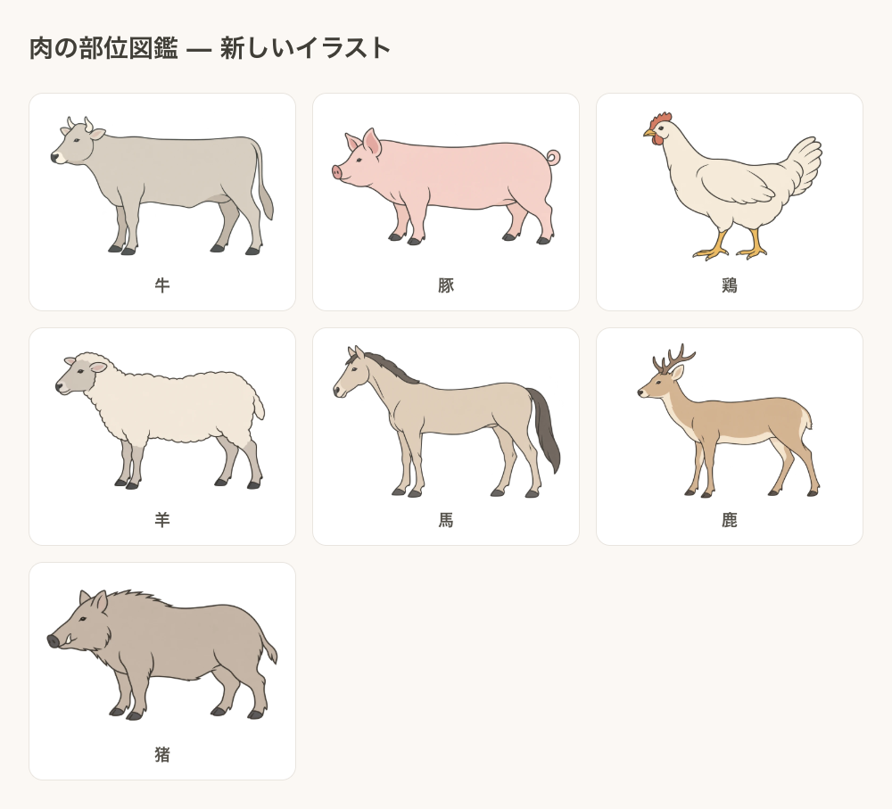

# 動物イラストの刷新

実施日：2026年10月17日。

## 変更内容

牛・豚・鶏・羊・馬・鹿・猪の7種類を、淡い単色と滑らかな輪郭を使ったフラットなイラストへ刷新した。左向きの側面図にそろえ、細かな毛並み・複雑な部位の切断線・背景の装飾を省いた。

一覧カードは図を上、解説を下に配置。図の表示幅を従来124pxから最大288pxへ広げた。詳細の図は最大330pxを維持した。赤丸は細い赤枠と白縁へ変更し、発光と影を除いた。

新しい絵に合わせて牛・豚・鶏ごとの座標を定義し、羊・馬・鹿・猪は項目ごとに指定した。独立した目視レビューで牛すねの位置が蹄に近すぎる指摘を受け、前後とも上の筋肉がある脚へ移動した。部位の境界を示す正確な解剖図ではなく、おおよその位置を示す模式図である。内部の器官やヒレなどの丸印を省略する仕様は継続した。



## 保存した画像

すべて900×600px、3:2、アルファ透過を維持したWebP。7枚合計338,386バイト。Sharpで縮小・WebP形式へ変換した。原画生成には組み込みの画像生成ツールを使用し、有料API用CLIは使用していない。

```text
image/illustrations/beef-cattle.webp
image/illustrations/pig.webp
image/illustrations/chicken.webp
image/illustrations/sheep.webp
image/illustrations/horse.webp
image/illustrations/deer.webp
image/illustrations/wild-boar.webp
```

生成指示の全文は[生成指示JSON](2026-10-17_イラスト生成指示.json)に記録した。最初に牛を生成し、さらに線と色面を簡素化した。その完成画像を他6種のスタイル参照に使用した。参照画像の動物をそのまま流用する指示ではなく、種類・体形・顔・足・尾などをそれぞれ指定した。

旧画像は履歴・参照用として残し、アプリからの参照は新しいWebPへ切り替えた。本文と栄養データは今回変更していない。

## 検証

- 全48項目から有効な画像パスが生成され、7種類すべての読み込みに成功。
- 全7画像のサイズ900×600・アルファありを確認。図とマーカーは同じ3:2キャンバスを基準に配置。
- 幅320・390・768・1280pxで、家庭・焼肉・栄養の3モードに横はみ出しなし。
- 320px幅の図は247px、390px以上は最大288px。スマホ画面で画像の切れ・変形がないことを目視確認。
- 牛・豚・鶏・羊・馬・鹿・猪の部位図24サンプルを目視確認。上記すねの位置調整後も確認。
- 7種の代表項目と牛ホルモンの詳細画面を開閉し、図・丸印の有無・参照資料を確認。
- カテゴリ件数は牛15・豚8・鶏8・牛ホルモン11・その他6。家庭48・焼肉31・栄養48件、成分値未掲載8件を確認。
- JavaScript構文チェックと差分の空白検査を通過。ブラウザコンソールはエラー0・警告0。
- 物理iPhoneでは未確認。スマホ幅のブラウザ表示で確認した。
